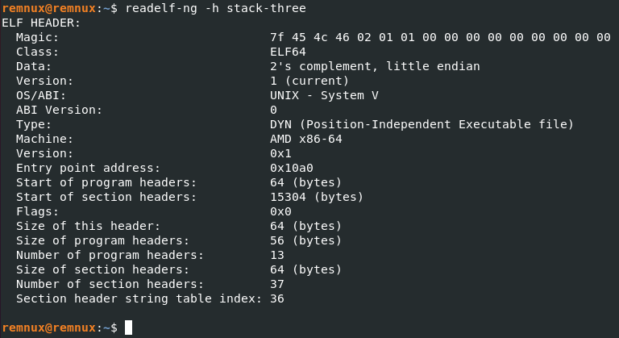
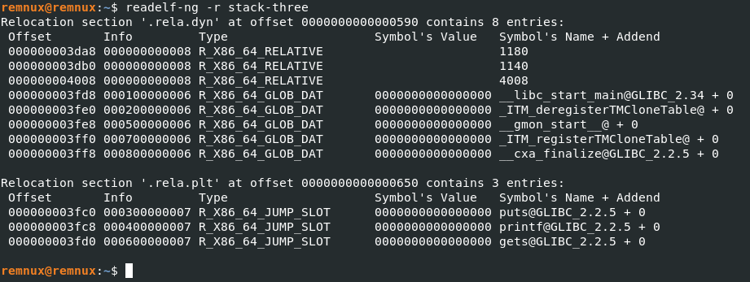
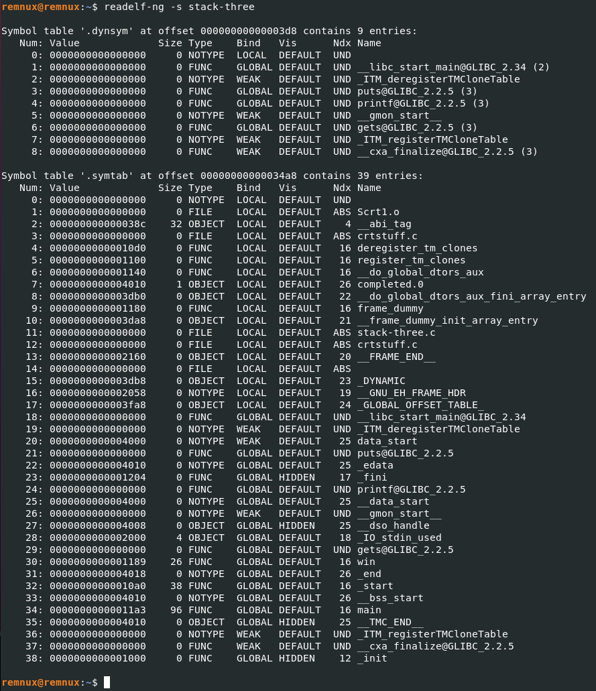
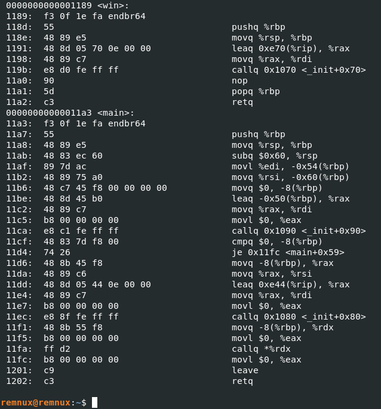

```bash
gcc -o stack-three stack-three.c -I. -O0 -Wall -ggdb -fno-stack-protector -z execstack
```

```bash
readelf-ng -h stack-three
```

```bash
readelf-ng -r stack-three
```

```bash
readelf-ng -s stack-three
```

```bash
readelf-ng -m .text stack-three
```

```bash

```

